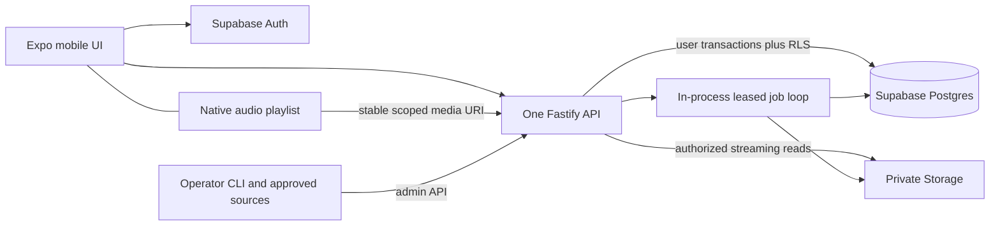

# Architecture: a regional music app with Spotify-style listening

Date: 2026-10-24. Inputs: [recon.md](recon.md), [features.csv](features.csv), and [regional-competitors.md](regional-competitors.md).

Build **one iOS/Android app, one API deployment, and one managed Postgres database**. The catalog accepts local and international repertoire without a local-only software restriction. Its source is replaceable. This document does not claim knowledge of Spotify, Aydym, or Belet's private architecture.

Original architecture status: SQL draft with local database verification. Implementation subsequently proceeded through design, build, and backend. See [implementation-verification.md](implementation-verification.md) and [backend.md](backend.md) for the current local prototype, deviations, and unperformed staging/native acceptance. No provider account, cloud resource, subscription, catalog agreement, or hosted deployment was created.

## Working assumptions

- No preferred stack was supplied, so use managed services and a shared mobile codebase. Launch languages provisionally use Turkmen/Russian with English fallback; validate copy and search expectations during design. Preserve Unicode display text.
- Start with on-demand online music, private personal playlists, curated editorial collections, and reliable device playback. Follow the 32 must-have feature rows before optional expansion.
- Use supplied, processed MP3 test tracks for the first slice. A broad catalog is a product target, not a promise that every song has already been sourced. Supplier and artist intake run as a parallel commercial workstream.
- Monetization, offline downloads, public playlist sharing, creator self-service, and recommendation-model sophistication remain later capabilities. Do not default to Stripe without checking the actual merchant entity, supported market, and store purchase route.
- Cloud choices below are provisional until actual Turkmenistan phones can reach Auth, API, storage/media, recovery links, and app builds. Do not infer reachability or best hosting region from a map.

## Stack and reasons

| Layer | Choice | Why / boundary |
| --- | --- | --- |
| Mobile | Expo + React Native + TypeScript; Expo Router | One mobile codebase with native navigation and development builds; pin a compatible stable SDK/package set at implementation |
| Styling | React Native StyleSheet and shared design tokens | No web styling layer; replica-design defines original type/color/spacing/component tokens |
| Audio | expo-audio native AudioPlaylist behind a small PlaybackEngine adapter | Current official documentation includes playlist and background controls; validate the exact pinned version on devices before expanding UI [T1] |
| Local state | Root-lifetime playback controller; query cache for server DTOs; expo-sqlite for bounded queue/checkpoint/outbox | Navigation must not own the audio engine's lifecycle; local restore does not depend on network [T2] |
| Native credentials | expo-secure-store adapter | Keep refresh credentials and media leases out of ordinary SQLite, application logs, and source control [T3] |
| Backend | Node LTS + TypeScript + Fastify, one modular monolith | Shared HTTP validation and streaming support; keep account, catalog, playlists, player, and operator modules in one deployment [T4] |
| Database | Supabase Postgres; private music schema | Managed database plus Auth/Storage without introducing multiple databases |
| Data access | Parameterized SQL through node-postgres; schema.sql as migration source | Direct transactions for ordered edits, receipts, and jobs; no ORM-generated second schema [T5] |
| Auth | Supabase Auth, email/password and recovery first | Provider-managed credentials; native app calls official SDK; API independently verifies bearer identity |
| Files | Supabase private Storage buckets for audio, artwork, and evidence | Backend authorizes reads; no competitor media URLs or publicly readable audio bucket [T6] |
| API hosting | One always-on Render web service, region chosen after local probes | Conventional Node process supports streaming and a small leased job loop; no per-track serverless invocation dependency [T7] |
| Email | Supabase Auth with custom SMTP, provisionally Resend | Confirmation/recovery delivery is part of the first slice; production SMTP and local delivery must be checked [T8] |
| Jobs | Postgres jobs table + bounded worker in same API deployment | Durable deduplication and lease recovery without another queue/database |
| Mobile builds | Expo development builds and EAS Build | Native playback behavior must be tested outside a browser; hosted iOS builds avoid depending on a Windows iOS compiler [T9] |
| Payments | Deferred provider adapter; official store/provider APIs only | No live billing keys, receipt trust path, or payment tables in the first migration |
| Observability | Structured redacted API logs, health checks, bounded playback metrics | Measure first-audio latency, rebuffering, range failures, job failures, and database contention; no third-party analytics integration initially |

A managed service is not automatically free at production usage. Do not select a sleeping host for continuous music. Set spending/egress alerts before a hosted pilot. No cost quote or user capacity is assumed here.

Suggested implementation layout: `apps/mobile`, `apps/api`, `packages/contracts`, and `supabase/migrations`. Do not create a web listener app or creator website for this slice. There is no Git repository in the current projectless workspace; these artifacts are a handoff, not committed application code. Initialize the implementation repository when the build phase starts.

## Database: 27 tables and explicit access rules

See [schema.sql](schema.sql). It targets a fresh Supabase Postgres 17+ project, references provider-managed auth.users by its primary key, and does not modify Auth internals. SQL creates no login/password. Separate deployment provisioning must bind a restricted server login to music_user and a separately protected operator/worker login to music_admin. Neither login is the database owner, a superuser, or a BYPASSRLS role.

| Tables | Purpose | Ownership / access |
| --- | --- | --- |
| profiles, user_preferences | App identity, locale, playback/library preferences | user_id ties to Auth identity; own rows only; listener cannot edit profile state |
| catalog_sources, media_assets, track_sources, content_permissions | Provenance, storage locations, supplier mappings, territory/use windows | Operator/worker only; never exposed in listener DTOs |
| artists, albums, tracks, track_artists, album_tracks | Independent music catalog with featured credits and release order | Listener reads published metadata only; no client catalog writes |
| playlists, playlist_items | Personal and operator-curated editorial playlists | Personal owner edits; published editorial read; composite ownership FK |
| saved_tracks, saved_albums, saved_playlists, saved_artists | Independent likes/saves/follows | Own rows; unique user/target pairs; saving one kind never saves another |
| playback_sessions, queue_entries | Per-installation recovery checkpoint and ordered queue | Own rows; current item constrained to the same session and user |
| playback_grants | Hashed media lease credential | Operator-side access module only; creation still requires authenticated session ownership |
| listening_events | Best-effort Recents/engagement | Own rows, stable client event IDs, bounded retention; not a royalty ledger |
| home_collections, home_collection_items | Curated localized discovery rows | Read published rows; operator writes; each tile has exactly one real FK target |
| operation_receipts | Idempotent mutation intents and results | Own user-scoped operations; no auth/media/upload secrets in cached responses |
| jobs, audit_events, rate_limit_buckets | Durable work, minimal audit trail, shared quotas | Operator/worker only; no native-app access |

This expands the recon's 14 conceptual entities into normalized storage, mapping, and operational tables. Optional entitlements/download records are deliberately absent rather than unimplemented tables pretending those features exist.

All tables have UUID primary keys with generated defaults, creation/update timestamps, explicit FK deletion actions, indexed FK/query paths, status checks, and enabled/forced RLS. Application timestamps use timestamptz/UTC; album release_date is an intentional calendar date. No monetary data is stored yet; future prices use integer minor units plus ISO currency, never floating point.

Catalog records are withdrawn rather than routinely hard-deleted. RESTRICT protects references in queues, saves, credits, and playlists. Deleting an Auth user cascades owned application data; job/audit ownership uses SET NULL where completion tracking must survive briefly. Current queue membership uses a deferred composite FK, allowing one atomic queue edit while rejecting an invalid state at commit.

### Trust boundaries and transaction identity

The private music schema is not in the Supabase Data API exposed-schema list. anon/authenticated have no schema/table/function privileges here, so a mobile publishable key does not provide an alternative mutation path. RLS remains a second boundary inside the API [T10].

For each ordinary API request:

1. Verify the Supabase access token with the provider; do not trust a decoded, unsigned JWT or userId supplied in a body. Check profile state, except during own-profile bootstrap and deletion-status handling.
2. Acquire one node-postgres connection, BEGIN, SET LOCAL ROLE music_user, and set the verified subject in request.jwt.claims using set_config with transaction-local=true.
3. Perform parameterized queries and explicit resource authorization. RLS filters owned rows. Validate target visibility before saving a playlist and before populating an editorial tile.
4. COMMIT/ROLLBACK and release the same connection. Never set session-global claims on a pooled connection or use independent pool.query calls for one transaction [T5].

Operators use a separate, narrowly invoked music_admin pool after server-controlled role/MFA verification; ordinary request handlers cannot select that pool from client input. Source credentials and Storage secret keys exist only on the server. The schema's current_user_id helper reads a trusted setting; it is not itself an authentication mechanism. Staging must prove login grants, pool behavior, and RLS on the real managed project, not just the local fixture.

## Playback architecture

**One native audio playlist per installation.** Create it at the app root, not inside Now Playing. The UI subscribes to its state and can unmount freely. Configure playback-only native permissions, background playback, audio interruptions, and OS transport controls; no recording/microphone feature. Official expo-audio guidance specifically requires Android lock-screen controls for sustained background playback [T1].

The application PlaybackEngine interface owns `loadQueue`, `play`, `pause`, `seek`, `next`, `previous`, `setRepeat`, `setShuffle`, and event subscription. It shields screens from library-specific calls. On native interruption, reflect actual engine state; do not auto-resume over an incoming call or restart sound after headphones disconnect.

Queue rules are proposed product semantics:

- Give each entry a stable UUID; the same track may occur more than once.
- Preserve current item identity through reorder. Explicit requests play before remaining context, in request order. Clear queued requests removes upcoming explicit entries only.
- Shuffle is a materialized order, retaining a canonical context order locally for toggling off. Persist the actual order and seed/order metadata locally; do not re-randomize on every render.
- Repeat-one repeats the current entry; manual next still advances. Repeat-all wraps the materialized queue; unavailable entries are skipped with a bounded scan and a recoverable stop if nothing is playable.
- Apply transport instantly for entries already acknowledged by the server. Serialize queue membership/order mutations and await their CAS commit before installing new entry URIs or the changed order in the native engine. The UI may show a pending edit; failure restores/reconciles the acknowledged snapshot. Coalesce only cursor/options checkpoints, not membership changes. Keep this command pipeline ordered so an older checkpoint response cannot overwrite a newer queue revision.

### Why a stable media lease instead of short-lived per-track URLs

A per-track URL minted by a React callback can fail when the UI is suspended, and a long preloaded queue can outlive short signed URLs. A32 issues one random 256-bit bearer lease for the owned session, valid at most 24 hours. Store only its SHA-256 hash in playback_grants. The native playlist uses stable per-entry URLs through A34/A35; it does not need a fresh mobile Auth token to advance every track while the UI sleeps. Initial playback/new contexts require A28 acknowledgement and a valid lease before handing the queue to native audio; automatic-next between those committed entries needs no UI callback.

On **each new GET/HEAD/range request**, the API checks the hashed lease, expiry/revocation, active profile, session+entry ownership, explicit preference, and current track/source/asset/permission availability. music.can_stream is only the catalog predicate; it does not replace the other checks. Determine territory using a trusted server-side resolver chosen during the regional probe; do not authorize using profile.country_code, query parameters, or spoofable country headers. No such resolver is installed by this architecture. Until validated, a restricted-territory commercial catalog is a launch dependency; local fixtures explicitly supply a test territory.

The API then streams the selected private object with backpressure, forwarding valid single byte ranges and necessary headers without buffering an entire file or exposing the private Storage URL. Native seek, next, background behavior, and HEAD/206/416 handling must be tested with this exact path. A signed Storage URL may be used internally for a short server fetch, not handed to the native client as a persistent queue credential [T6].

Tradeoff: proxying media through the monolith adds a bandwidth hop, concurrent connections, and potential double egress charges. Start this way for a small pilot to make access behavior testable. Move the same media URI contract to a purpose-built authorized CDN/edge delivery layer after measuring cost and concurrent streams. This is not a Spotify-scale architecture.

Revocation prevents new authorized reads; audio already transferred/buffered cannot be recalled. An in-flight response may finish unless explicitly aborted. This lease scheme is access control, **not DRM**. If a supplier requires DRM, device binding, or tighter withdrawal guarantees, revise delivery before accepting that supplier. At 24h expiry, require lease renewal on foreground/re-authentication; do not promise indefinite unattended playback. Never put lease tokens in logs, analytics, query caches, or operation receipts.

For the first slice use one supplied 128-kbps MP3 rendition. Adaptive streaming, lossless, crossfade, and offline encrypted storage are later. Do not show a data-saver quality choice until a real lower-bitrate variant is supplied and tested.

## API and catalog pipeline

The route-by-flow contract is in [api.md](api.md): **54 unique method-path pairs** including operator and health routes. Five official Auth SDK operations are listed separately. Route names, request/response fields, status semantics, ownership, limits, and retry policy are documented; handlers/runtime validation schemas are still build work.

Import pipeline: approved source → controlled upload → validate audio/artwork and manifest → map stable source/external IDs → reviewed permission records → publish metadata → curate Home. Source adapters normalize into the same catalog contract. No listener screen knows which supplier delivered a track.

- MVP import accepts already processed files; no public user upload and no “fetch any URL” handler. Validate MIME/magic bytes, declared size, duration, checksum, and actual audio/image decodability before ready status.
- The operator upload ticket is short-lived and scoped to one source/asset/key. Retried upload preparation returns the same asset intent with a fresh ticket, not a stale cached secret URL.
- Use source_id+external_id for feed idempotency. ISRC is a matching hint, not a universal unique key: versions and multiple supplier deliveries need review.
- Publish only when source mapping, credits, audio kind/status, artwork permissions, and applicable evidence are consistent. Availability is recalculated on playback even after publication.
- Record withdrawals synchronously before scheduling cleanup. Invalidating only a search cache is insufficient. Update assets/permissions/catalog state and preserve user playlist entries as unavailable references where appropriate.
- Creator self-service can later reuse the importer behind verified accounts and moderation. Belet Studio is an operating-model reference; its internal contracts are unknown. The regional examples do not need to be copied as media sources.

## The parts that bite

| Concern | Decision and verification |
| --- | --- |
| Idempotency | Atomically INSERT receipt under unique (user_id,scope,request_key), bind canonical body hash, and commit effect/result in the same transaction. Duplicate key+same body replays result; changed body is 422; an in-flight conflicting operation waits briefly then returns 409/Retry-After. Do not SELECT-then-act. Retain 7 days, longer than the client retry/outbox window. No money/external side effect is retried merely because HTTP timed out. |
| Playlist races | CAS revision plus a locked parent row; append/delete/reorder all share this rule. Delivered replace_playlist_items function is atomic and preserves stable entry IDs and original addition times. Reject stale edits; return the latest revision so the user can review conflicts. |
| Queue races | Unique user/installation session; same-row CAS transaction updates queue, current entry, and cursor. Deferred ownership FK must pass at commit. Native engine remains authoritative for current sound; server is recovery state, not multi-device handoff. |
| Search | PostgreSQL simple text-search config + GIN and indexed title/prefix paths. Preserve original spelling, normalize NFC at import/query, escape LIKE wildcards, and bind query text. Populate artist/title aliases deliberately. No automatic Turkmen/Russian transliteration or Spotify recommendation parity is assumed [T11]. |
| Network | HTTPS range streaming, bounded retry with jitter, cancellation/backpressure, and explicit buffering/error states. Test mobile data and Wi-Fi within the target region. Do not ship a host selection that only works from the development machine. |
| Rate limits | Shared Postgres buckets with atomic UPSERT, keyed by hashed principal/IP and route family. Initial configurable targets: JSON 120/min/user; search 30/min/user; leases 10/min/user plus 5 live/install; stream concurrency 2/user with separate range-request abuse monitoring. Supabase Auth has separate provider limits. Tune from pilot data; in-memory counters are not sufficient across replicas. |
| Jobs | At-least-once execution, unique dedupe keys, bounded leases, retries, and failed-state review. Never do audio transcoding on the HTTP request path. Start with preprocessed files; later isolate heavy processing even if it remains one deployment. |
| Time and expiry | Store timestamps UTC; compare permissions/leases using server time. Validate clock skew in client events; release_date stays a calendar date. No DST logic in track durations. |
| File safety | Operator upload limits: 100 MiB audio, 5 MiB images, 10 MiB evidence. Use generated keys; never execute file names or interpolate them into shell commands. Control egress hosts and redirects for any future supplier fetcher. |
| Realtime and offline | No WebSocket dependency and no cross-device live session sync initially. SQLite checkpoints/outbox are not a licensed offline music download feature. Warn/reconcile on stale edits; do not silently merge conflicting playlist orders. |
| Email | Custom SMTP, authenticated sending domain, allowlisted recovery links, generic sign-in errors, and actual local inbox delivery checks. Provider development defaults are not a production delivery plan [T8]. |
| Isolation | Single consumer product, no organizations initially. user_id is the ownership boundary. Operator access cannot be granted through user-editable profile metadata. |
| Deletion and retention | Deletion request immediately disables account/leases, then an idempotent job removes provider identity and owned data. Clear device credentials/checkpoints on sign-out. Keep engagement events 90 days, receipts 7 days, quota buckets until expiry, redacted logs/audit 30 days, completed jobs at most 7 days; deletion jobs discard subject payload within 24h of completion. Backups follow the chosen plan's retention and must not be restored into active use without replaying erasures. These are proposed defaults, not legal conclusions. |
| Media economics | At 128 kbps, one hour is about 57.6 MB of encoded audio before protocol overhead. Budget object egress and API egress separately; load-test realistic concurrency before promising capacity. |

### Job schedule

These are application worker schedules, not Codex reminders. Nothing has been scheduled or activated.

| Job | Trigger/schedule | What it does / recovery |
| --- | --- | --- |
| Catalog import | B02 enqueue; worker polls every 10s | Lease up to 5 min; bounded manifest batch; checksum/source mapping idempotency; 5 attempts with exponential backoff; manual review on failure |
| Account deletion | A38 enqueue; poll every 10s | Mark deleting/revoke synchronously; clean approved owned prefixes and Auth identity; treat already removed as success; retry up to 5 times, then alert |
| Withdrawal follow-up | B08 enqueue; poll every 10s | Access-blocking state commits before enqueue result; clean stale caches/derived entries; retry safely |
| Expiry/retention cleanup | Hourly; worker records a dedupe slot | Purge expired leases/receipts/quota buckets and retained events/jobs/audit in indexed batches; never delete active media based only on a guessed object path |

Worker claims use FOR UPDATE SKIP LOCKED plus locked_until and attempt count. Reclaimed jobs repeat only idempotent steps. A transaction records each cleanup slot so multiple API instances do not run the same slot concurrently. A sleeping/free host is unsuitable for required cleanup or continuous streaming.

## Build order and evidence gates

| Milestone | Screens / features | Tables | Routes | Exit evidence |
| --- | --- | --- | --- | --- |
| 0. Connectivity + native proof | S12/S20; technical spike | Local fixtures; no paid catalog required | Temporary authorized test stream; future A34/A35 semantics | Physical Android and iPhone: 30 minutes locked, automatic next across 3+ tracks, seek, pause from OS, call interruption, Bluetooth/headphone change; probe Auth/API/recovery from target-region networks. If native queue fails while JS sleeps, change engine here before styling screens. |
| 1. First vertical slice | S01–S03/S05/S06/S09/S10/S11/S12/S14–S16/S20; F01/F03/F05–F07/F11 | profiles, preferences, minimal source/assets/artist/track/permission records, playlists/items, saves, playback sessions/entries/grants, receipts | Auth SDK; A01/A02/A05/A10/A14–A16/A21/A24/A27–A29/A32–A35/A43; minimal operator seed/import path | Register → search supplied audio → hear it → lock phone/advance → like → create playlist/add → restart paused and restore data. Use API/persistent records, not fake buttons. |
| 2. Must-have catalog and resilience | Remaining S04/S07/S08/S13/S17/S18; M01–M32 by area | All core tables; editorial collections, imports, audit/jobs/quotas | Remaining core listener/operator/health routes, including deletion and CAS edits | Every must row has evidence; cross-user attempts fail; stale edits are visible; unavailability/empty/error states work; media ranges and token redaction tested; real managed RLS deployment verified. |
| 3. Should-haves | S19 and enhancements to existing surfaces; F12; S01–S12 feature rows | saved_artists/listening_events plus existing catalog/preferences | A39–A42/A44 and extensions to existing endpoints | Localized search/copy, library organization, safe retries, Recents, artist following, actual quality variant only when available. Add no fake quality toggle. |
| 4. Could-haves | S21/S22 and selected C01–C06 only | Separate migrations for entitlements/downloads/sharing/creator intake | Separate reviewed contracts and verified provider webhooks | Commercial model and supplier requirements selected before billing/offline design; user chooses additions rather than all six arriving by default. |
| 5. Differentiate | Work from replica-entrepreneur findings | Only tables justified by selected fixes | Only routes justified by selected fixes | Public-review evidence → ranked fixes → measurable improvement; no assumed regional pain points presented as findings. |

Milestone 0 uses throwaway native fixtures before the full first slice because playback reliability is the largest technical uncertainty. This does not replace milestone 1's persisted end-to-end proof. A browser screenshot cannot verify native playback.

Provisional pilot targets to measure: first audio within 3s and search within 1s on a named test device/network; API metadata p95 below 500ms excluding mobile last mile. These are proposed targets for a small defined pilot, not measured results or a production SLA. If missed, investigate the trace/route/encoding bottleneck instead of weakening the targets silently.

## Verification performed and still required

The delivered schema and atomic playlist edit were executed in a disposable PGlite PostgreSQL 18.6 instance with simulated provider users/roles: **27 checks passed**. See [schema-validation.json](schema-validation.json), [tests/schema.test.sql](tests/schema.test.sql), and [verification.md](verification.md). Local checks exercise ownership, restricted schema access, permission windows/withdrawal, queue membership, edit rollback, revision conflicts, Unicode text, and account cascades. They do not run against a real Supabase project or verify PostgreSQL 17 deployment compatibility.

Still required during implementation: actual managed-role provisioning and migrations; HTTP schemas/handlers and auth verification; storage bucket policies; byte-range streaming and cancellation; concurrent-client transaction/load tests; device playback; local reachability/email delivery; complete importer validation; account erasure across Storage and provider services. The API contract and milestones describe future behavior, not completed runtime features.

No production secrets were read or stored. The catalog supplier, verified territory resolver, distribution/payment feasibility for the operating entity, and commercial music coverage remain explicit launch dependencies. They do not prevent building the player and catalog pipeline with supplied test audio.

Next step: **replica-design** for the 20 core listener surfaces and shared native components, informed by the early playback/connectivity spike. Use original identity/assets and mark the native visual reference gaps from recon. Then replica-build implements the first vertical slice; replica-backend wires the managed services and operational paths.

## Official technical sources

Read 2026-10-24. Technology choices are recommendations; implementation pins tested versions instead of depending on a floating documentation alias.

| ID | Source | Supports |
| --- | --- | --- |
| T1 | https://docs.expo.dev/versions/latest/sdk/audio/ | Native playlist API, background configuration, lock-screen controls |
| T2 | https://docs.expo.dev/versions/latest/sdk/sqlite/ | Device-local database |
| T3 | https://docs.expo.dev/versions/latest/sdk/securestore/ | Native credential storage |
| T4 | https://fastify.dev/docs/latest/Reference/Validation-and-Serialization/ | HTTP boundary validation/serialization approach |
| T5 | https://node-postgres.com/features/transactions | One checked-out connection per transaction |
| T6 | https://supabase.com/docs/guides/storage/security/access-control | Private storage authorization boundary |
| T7 | https://render.com/docs/web-services | Conventional Node web service hosting |
| T8 | https://supabase.com/docs/guides/auth/auth-smtp | Custom SMTP for Auth mail |
| T9 | https://docs.expo.dev/build/introduction/ | Hosted native build workflow |
| T10 | https://www.postgresql.org/docs/current/ddl-rowsecurity.html | Row policies, privileges, role/owner boundaries |
| T11 | https://www.postgresql.org/docs/17/textsearch-controls.html | Text-search tokenization/query/ranking primitives |
| T12 | https://supabase.com/docs/guides/database/connecting-to-postgres | Managed Postgres connection choices |
| T13 | https://supabase.com/docs/guides/auth/managing-user-data | Provider identity references and user data lifecycle |
| T14 | https://pglite.dev/docs/ | Local disposable PostgreSQL verification runtime |
